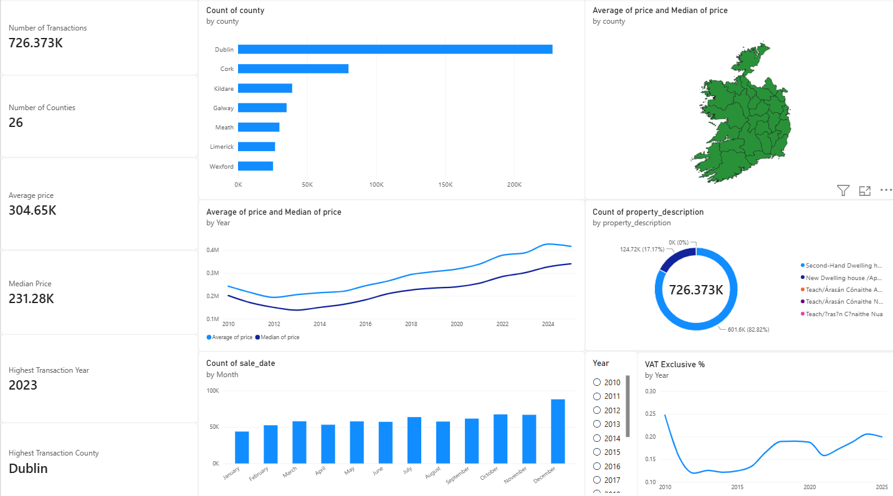
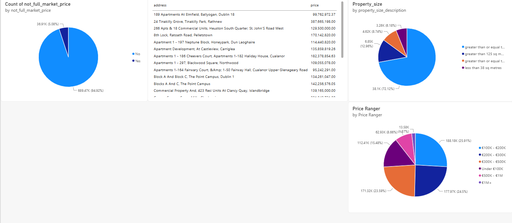

# Ireland Property Price Analysis

## 📌 Project Overview

An end-to-end data analysis project exploring Ireland's residential property market using **726K+ property transactions** across **26 counties**.

The project focuses on data cleaning, exploratory analysis, SQL-based business analysis, and interactive Power BI visualization to identify property price trends, transaction patterns, county-level differences, and market characteristics.

---

## 🎯 Objectives

- Analyze property price trends over time
- Compare property prices across Irish counties
- Examine transaction volume and market distribution
- Compare average and median property prices
- Analyze new vs. second-hand properties
- Identify major property price segments
- Examine VAT-exclusive and non-full-market-price transactions
- Identify monthly and yearly transaction patterns

---

## 🛠️ Tools & Technologies

- **SQL / PostgreSQL** — Data cleaning, transformation and analysis
- **Power BI** — Interactive dashboard and data visualization
- **Git & GitHub** — Version control and project documentation

---

## 📊 Dataset

The analysis contains **726,373 property transactions** covering **26 Irish counties**.

Key fields include:

- Sale Date
- Property Address
- County
- Eircode
- Property Price
- Full Market Price Indicator
- VAT Exclusive Indicator
- Property Description
- Property Size Description

---

## 🧹 Data Cleaning

The raw property data was cleaned using SQL before analysis.

Key cleaning steps included:

- Converting sale dates into proper `DATE` values
- Removing currency symbols and commas from price values
- Converting price values into numeric format
- Trimming and standardizing property addresses
- Creating a cleaned analytical table
- Validating price ranges and transaction records

---

## 🔍 SQL Analysis

The analysis used a range of SQL techniques, including:

- Aggregations
- `GROUP BY`
- CTEs
- Window Functions
- `RANK()`
- `DENSE_RANK()`
- `ROW_NUMBER()`
- `LAG()`
- `FIRST_VALUE()`
- `LAST_VALUE()`
- `PERCENTILE_CONT()`
- Conditional aggregation
- `FILTER`
- Date functions
- Running averages
- Percentage calculations

---

## 📈 Power BI Dashboard

### Dashboard 1



### Dashboard 2



---

## 💡 Key Insights

### 1. Overall Property Market

The dataset contains **726,373 transactions** across 26 counties.

The overall average property price was approximately **€304.65K**, compared with a median price of approximately **€231.28K**.

The difference between the average and median indicates that the property-price distribution is influenced by higher-value transactions.

### 2. Dublin Had the Highest Transaction Volume

Dublin recorded the highest number of property transactions among the 26 counties, followed by other major counties such as Cork and Kildare.

This highlights a strong concentration of recorded property market activity in Dublin.

### 3. Long-Term Price Growth

Property prices showed a strong upward trend over the analyzed period, particularly during the later years of the dataset.

The analysis also identified periods with lower transaction activity and years where the difference between average and median prices was particularly large.

### 4. Second-Hand Properties Dominated Transactions

Second-hand properties represented approximately **82.82%** of all transactions, while new properties accounted for approximately **17.17%**.

This indicates that the dataset is heavily concentrated in the resale property market.

### 5. Most Transactions Were Between €100K and €500K

The largest individual price segment was **€100K–€200K**, representing approximately **25.91%** of transactions.

The €200K–€300K segment represented approximately **24.50%**, while €300K–€500K represented approximately **23.59%**.

Together, these three segments accounted for approximately **74% of all transactions**.

### 6. Transaction Activity Showed Seasonality

Monthly transaction analysis showed that **January had the lowest transaction activity**, while **December recorded the highest number of transactions**.

This indicates a noticeable seasonal pattern in property transaction volumes.

### 7. Full-Market-Price Transactions Dominated

Approximately **94.92%** of transactions were classified as full-market-price transactions, while approximately **5.08%** were classified as not-full-market-price transactions.

### 8. VAT-Exclusive Transactions Varied by County

VAT-exclusive transaction rates varied considerably across counties and over time.

Several counties, including Kildare, Meath, Wicklow, Louth, Laois, Cork and Dublin, showed relatively high VAT-exclusive proportions compared with other counties.

---

## 📋 Business Takeaways

- Dublin represents the strongest concentration of transaction activity.
- The market is predominantly driven by second-hand properties.
- The €100K–€500K price range represents the core transaction segment.
- Average prices can be significantly affected by high-value properties, making median price an important complementary KPI.
- Property transaction activity shows noticeable monthly seasonality.
- VAT-related transaction characteristics vary significantly by county.

---

## 📁 Repository Structure

```text
ireland-analysis/
│
├── README.md
├── ireland_property_queries.sql
├── .gitignore
│
└── images/
    ├── power-bi-dashboard-1.png
    └── power-bi-dashboard-2.png